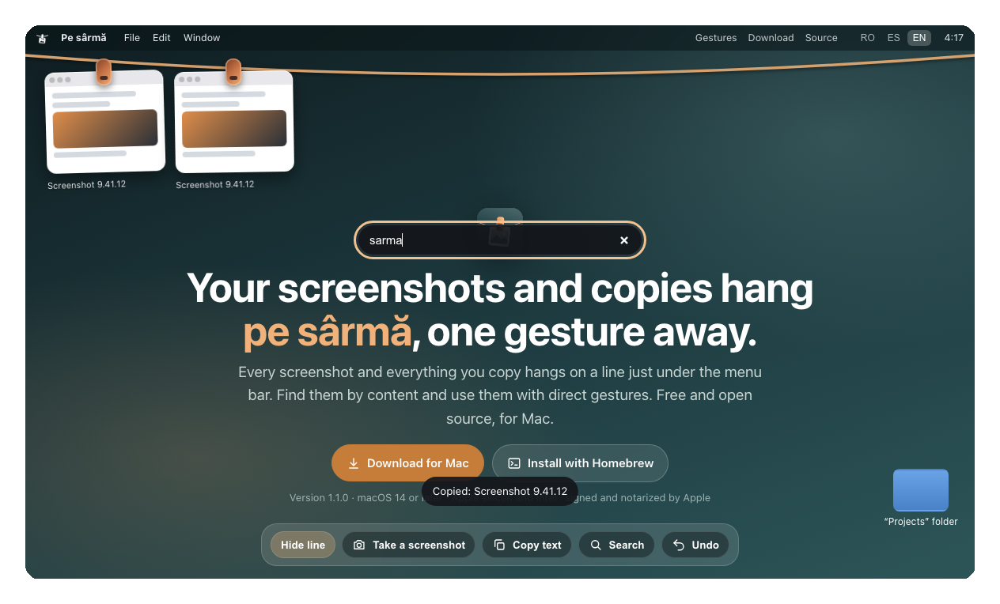
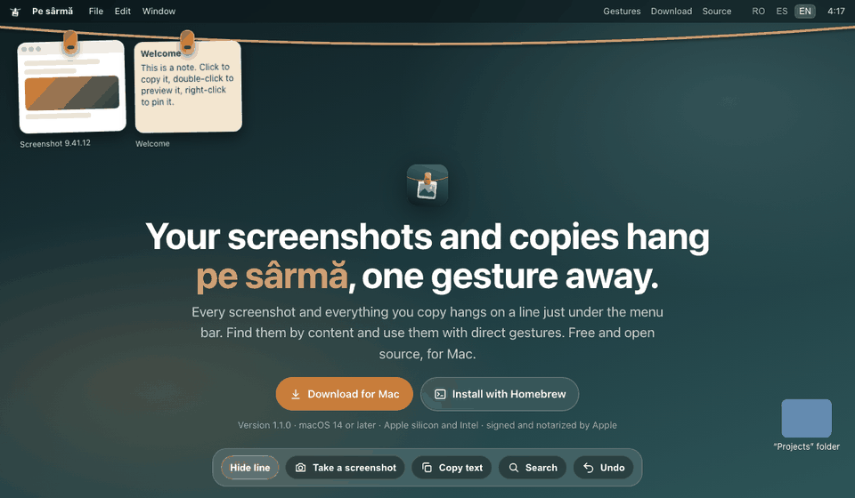

# Pe sârmă

[Română](README.md) · [English](README.en.md) · [Español](README.es.md)

**Pe sârmă — the Romanian edition, published and maintained by Cristi Gordaș.**

<p align="center"><a href="https://gordas.dev/pe-sarma/?lang=en"><picture><source media="(prefers-color-scheme: dark)" srcset="docs/media/poster-en-dark.png"></picture></a></p>

<p align="center"><a href="https://gordas.dev/pe-sarma/?lang=en"><b>Try the in-browser demo →</b></a></p>

Screenshots and everything you copy hang on a line right under the menu bar. Find them by content and use them with direct gestures. Free, open source, macOS 14 or later. No account, no activation key, no subscription, no trial period.

<p align="center"><br><sub>The line in motion: capture, copy, search, undo. The image is a demo with synthetic data.</sub></p>

## Install

Download the disk image and drag the app to Applications. It is signed with a Developer ID and notarized by Apple.

**https://github.com/gordasgdc/pe-sarma/releases/latest/download/PeSarma.dmg**

Or with Homebrew (the same notarized DMG from Releases):

```sh
brew install --cask gordasgdc/tap/pe-sarma
```

## Gestures

| Gesture | Effect |
|:--|:--|
| Click | Copies. A note is copied with its formatted text. |
| Long press | Opens in Markup. A note opens for editing. |
| Double click | Opens in Preview. A link opens in the browser. |
| Force Touch | Quick Look. |
| Drag into an app | Sends a copy. It stays on the line. |
| Drag into a folder | You keep it there. It leaves the line. |
| Drag to the Trash or click the cross | Discards it. |
| Shift-click | Select several; the menu, ⌘C, ⌫ and dragging act on all of them. |
| ⌘Z with the cursor on the line | Undoes the last action, including for a selection. |
| Space over an image | Quick Look. |
| Right click | Share, pin to the line, keep in front of windows, show in Finder. |
| In Finder: right click → Hang on the line | Hangs it, pinned. |
| Cursor in the middle of the menu bar | Brings the line down on that screen. |
| ⌃⌥T | Shows or hides the line (configurable). |
| ⌃⌥F | Searches the line (configurable). |

## What it does

- **Screenshots and screen recordings** hang on the line the moment you take them. Long-press a recording to trim it.
- **What you copy**: images, text (as a note; formatted Markdown, code with its lines kept) and links, each switchable under “Hang what I copy”.
- **Search** the text inside screenshots (read locally, with the system text recognition), notes and links. Diacritics are ignored: “sarma” finds “sârmă”.
- **Privacy**: nothing is kept from password fields, from what a password manager marks as private, or from another device through Universal Clipboard. No network, no statistics.
- **Three languages**: Romanian, Spanish and English, following the system language (Romanian by default) or the language set for the app in Settings.

## Permissions and settings

If you let Pe sârmă handle screenshots, the app changes the macOS capture settings (`com.apple.screencapture`): the save location, the floating thumbnail and the destination. Your values are saved and put back when you turn it off and when the app quits. Pe sârmă watches the folder where macOS saves screenshots and, on request, folders you add; macOS may ask for access to Desktop, Documents or Downloads. If you refuse, the app keeps running and screenshots from that folder do not appear on the line.

## Build from source

```sh
git clone https://github.com/gordasgdc/pe-sarma.git
cd pe-sarma
PESARMA_BUILD_DIR=/path/to/build scripts/build-app.sh
open /path/to/build/PeSarma.app
```

Needs the Swift tools. Checks: `swift scripts/check-strings.swift`, `scripts/test-selection.sh`, `scripts/test-diagnostics.sh`. Disk image: `NOTARY_PROFILE=<profile> scripts/make-dmg.sh`. Visual identity: `PESARMA_BRAND_OUT=<folder> scripts/make-brand-assets.sh`. Updating from Tendedero: [docs/UPSTREAM.md](docs/UPSTREAM.md).

## Diagnostics

The local log is in `~/Library/Logs/PeSarma/`. The “Diagnostics” menu opens the folder, exports an inspectable ZIP (no screenshots, copied text or paths) and copies the session ID. Nothing is sent automatically.

## Credits and license

The app is based on [Tendedero](https://github.com/alejandrobujan/tendedero), created by Alejandro Buján (MIT license). Pe sârmă is the Romanian edition, published and maintained by Cristi Gordaș, with its own name, icon and materials. The code is MIT ([LICENSE](LICENSE), [NOTICE.md](NOTICE.md)); the name and icon of this edition are its own. The Tendedero name and icon are not reused.
