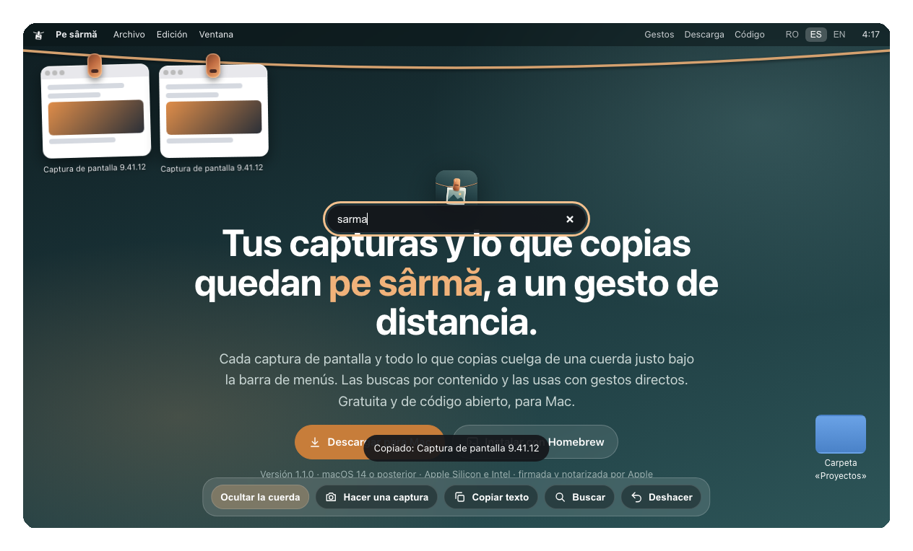
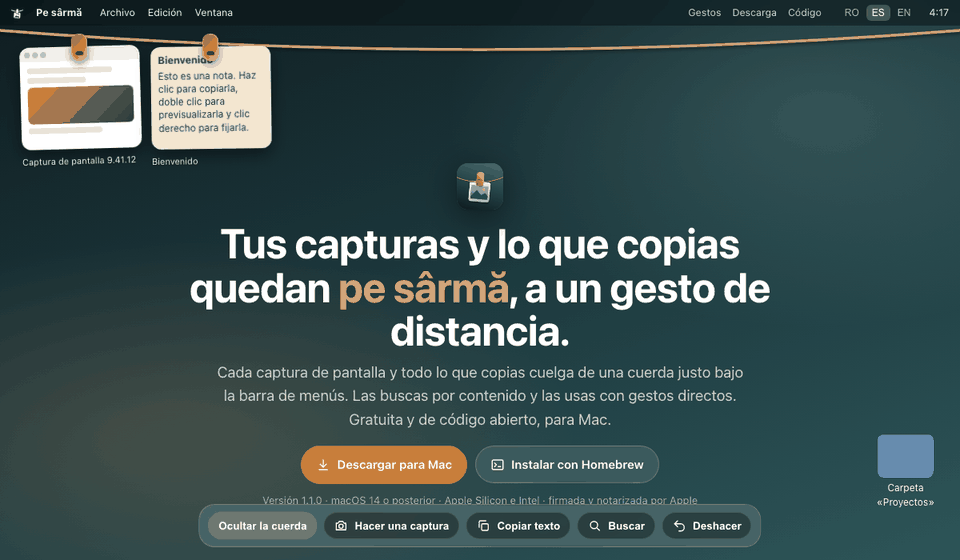

# Pe sârmă

[Română](README.md) · [English](README.en.md) · [Español](README.es.md)

**Pe sârmă — la edición en rumano, publicada y mantenida por Cristi Gordaș.**

<p align="center"><a href="https://gordas.dev/pe-sarma/?lang=es"><picture><source media="(prefers-color-scheme: dark)" srcset="docs/media/poster-es-dark.png"></picture></a></p>

<p align="center"><a href="https://gordas.dev/pe-sarma/?lang=es"><b>Prueba la demo en el navegador →</b></a></p>

Las capturas de pantalla y todo lo que copias se cuelgan de un hilo justo bajo la barra de menús. Las encuentras por contenido y las usas con gestos directos. Gratuita, de código abierto, macOS 14 o posterior. Sin cuenta, sin clave de activación, sin suscripción, sin periodo de prueba.

<p align="center"><br><sub>El hilo en movimiento: captura, copia, búsqueda, deshacer. La imagen es una demo con datos sintéticos.</sub></p>

## Instalación

Descarga la imagen de disco y arrastra la app a Aplicaciones. Está firmada con Developer ID y notarizada por Apple.

**https://github.com/gordasgdc/pe-sarma/releases/latest/download/PeSarma.dmg**

O con Homebrew (el mismo DMG notarizado de Releases):

```sh
brew install --cask gordasgdc/tap/pe-sarma
```

## Gestos

| Gesto | Efecto |
|:--|:--|
| Clic | Copia. Una nota se copia con su texto con formato. |
| Pulsación larga | Abre en Marcado. Una nota se abre para editar. |
| Doble clic | Abre en Vista Previa. Un enlace se abre en el navegador. |
| Force Touch | Vista rápida. |
| Arrastrar a una app | Envía una copia. Sigue en el hilo. |
| Arrastrar a una carpeta | Te la quedas allí. Sale del hilo. |
| Arrastrar a la Papelera o clic en la cruz | La descarta. |
| Shift-clic | Selecciona varias; el menú, ⌘C, ⌫ y el arrastre actúan sobre todas. |
| ⌘Z con el cursor sobre el hilo | Deshace la última acción, también en una selección. |
| Espacio sobre una imagen | Vista rápida. |
| Clic derecho | Compartir, fijar en el hilo, mantener delante de las ventanas, mostrar en Finder. |
| En Finder: clic derecho → Colgar en el hilo | La cuelga, fijada. |
| Cursor en medio de la barra de menús | Baja el hilo en esa pantalla. |
| ⌃⌥T | Muestra u oculta el hilo (configurable). |
| ⌃⌥F | Busca en el hilo (configurable). |

## Qué hace

- **Capturas y grabaciones de pantalla** cuelgan del hilo en cuanto las haces. En una grabación, pulsa largo para recortarla.
- **Lo que copias**: imágenes, texto (como nota; Markdown con formato, código con sus líneas) y enlaces, activables por separado en «Colgar lo que copio».
- **Búsqueda** en el texto de las capturas (leído en local, con el reconocimiento de texto del sistema), en notas y enlaces. Ignora los diacríticos: «sarma» encuentra «sârmă».
- **Privacidad**: no se guarda nada de campos de contraseña, de lo que un gestor de contraseñas marca como privado ni de otro dispositivo por Portapapeles universal. Sin red, sin estadísticas.
- **Tres idiomas**: rumano, español e inglés, según el idioma del sistema (rumano por defecto) o el idioma fijado para la app en Ajustes.

## Permisos y ajustes

Si dejas que Pe sârmă gestione las capturas, la app cambia los ajustes de captura de macOS (`com.apple.screencapture`): la ubicación, la miniatura flotante y el destino. Tus valores se guardan y se restauran al desactivarlo y al cerrar la app. Pe sârmă vigila la carpeta donde macOS guarda las capturas y, si lo pides, las carpetas que añadas; macOS puede pedir acceso a Escritorio, Documentos o Descargas. Si lo rechazas, la app sigue abierta y las capturas de esa carpeta no aparecen en el hilo.

## Compilar desde el código

```sh
git clone https://github.com/gordasgdc/pe-sarma.git
cd pe-sarma
PESARMA_BUILD_DIR=/path/to/build scripts/build-app.sh
open /path/to/build/PeSarma.app
```

Requiere las herramientas de Swift. Comprobaciones: `swift scripts/check-strings.swift`, `scripts/test-selection.sh`, `scripts/test-diagnostics.sh`. Imagen de disco: `NOTARY_PROFILE=<perfil> scripts/make-dmg.sh`. Identidad visual: `PESARMA_BRAND_OUT=<carpeta> scripts/make-brand-assets.sh`. Actualizar desde Tendedero: [docs/UPSTREAM.md](docs/UPSTREAM.md).

## Diagnóstico

El registro local está en `~/Library/Logs/PeSarma/`. El menú «Diagnóstico» abre la carpeta, exporta un ZIP inspeccionable (sin capturas, texto copiado ni rutas) y copia el ID de sesión. No se envía nada automáticamente.

## Créditos y licencia

La app se basa en [Tendedero](https://github.com/alejandrobujan/tendedero), creado por Alejandro Buján (licencia MIT). Pe sârmă es la edición en rumano, publicada y mantenida por Cristi Gordaș, con nombre, icono y materiales propios. El código es MIT ([LICENSE](LICENSE), [NOTICE.md](NOTICE.md)); el nombre y el icono de esta edición son propios. El nombre y el icono de Tendedero no se reutilizan.
