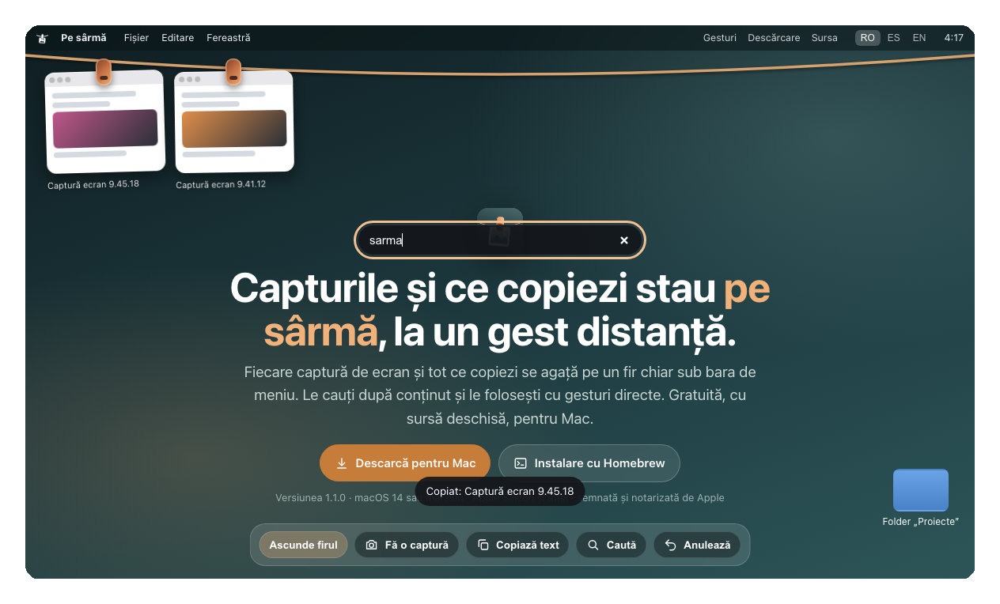
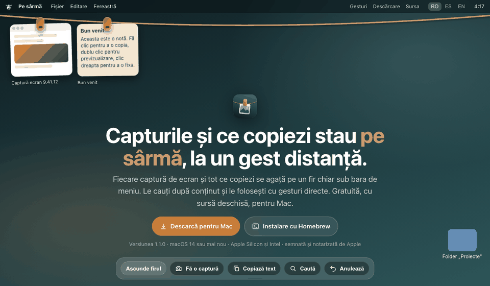

# Pe sârmă

[Română](README.md) · [English](README.en.md) · [Español](README.es.md)

**Pe sârmă — ediția în limba română, publicată și întreținută de Cristi Gordaș.**

<p align="center"><a href="https://gordas.dev/pe-sarma/?lang=ro"><picture><source media="(prefers-color-scheme: dark)" srcset="docs/media/poster-ro-dark.png"></picture></a></p>

<p align="center"><a href="https://gordas.dev/pe-sarma/?lang=ro"><b>Încearcă demonstrația în browser →</b></a></p>

Capturile de ecran și tot ce copiezi se agață pe un fir chiar sub bara de meniu. Le găsești după conținut și le folosești cu gesturi directe. Gratuită, cu sursă deschisă, pentru macOS 14 sau mai nou. Fără cont, fără cheie de activare, fără abonament, fără perioadă de probă.

<p align="center"><br><sub>Firul în mișcare: captură, copiere, căutare, anulare. Imaginea este o demonstrație cu date sintetice.</sub></p>

## Instalare

Descarcă imaginea disc și trage aplicația în Aplicații. Este semnată cu Developer ID și notarizată de Apple.

**https://github.com/gordasgdc/pe-sarma/releases/latest/download/PeSarma.dmg**

Sau cu Homebrew (același DMG notarizat din Releases):

```sh
brew install --cask gordasgdc/tap/pe-sarma
```

## Gesturi

| Gest | Efect |
|:--|:--|
| Clic | Copiază. O notă se copiază cu textul formatat. |
| Apăsare lungă | Deschide în Adnotare. O notă se deschide pentru editare. |
| Dublu clic | Deschide în Previzualizare. Un link se deschide în browser. |
| Force Touch | Previzualizare rapidă. |
| Tragere într-o aplicație | Trimite o copie. Rămâne pe fir. |
| Tragere într-un folder | O păstrezi acolo. Pleacă de pe fir. |
| Tragere în Coș sau clic pe cruciuliță | Scapi de ea. |
| Shift-clic | Selectezi mai multe; meniul, ⌘C, ⌫ și tragerea acționează asupra tuturor. |
| ⌘Z cu cursorul pe fir | Anulează ultima acțiune, inclusiv pentru o selecție. |
| Spațiu cu cursorul pe o imagine | Previzualizare rapidă. |
| Clic dreapta | Partajează, fixează pe fir, ține în fața ferestrelor, arată în Finder. |
| În Finder: clic dreapta → Agață pe fir | O agață pe fir, fixată. |
| Cursorul în mijlocul barei de meniu | Coboară firul pe ecranul respectiv. |
| ⌃⌥T | Arată sau ascunde firul (configurabil). |
| ⌃⌥F | Caută pe fir (configurabil). |

## Ce face

- **Capturi și înregistrări de ecran** apar pe fir în clipa în care le faci. Pe înregistrări poți apăsa lung pentru a le decupa.
- **Ce copiezi**: imagini, text (ca notă; Markdown formatat, cod cu liniile păstrate) și linkuri, activabile separat, la „Agață ce copiezi”.
- **Căutare** în textul din capturi (citit local, cu recunoașterea de text din sistem), în note și în linkuri. Ignoră diacriticele: „sarma” găsește „sârmă”.
- **Confidențialitate**: nu se păstrează nimic din câmpurile de parolă, din ce marchează ca privat un manager de parole sau din alt dispozitiv prin Clipboard universal. Fără rețea, fără statistici.
- **Trei limbi**: română, spaniolă și engleză, după limba sistemului (română implicit) sau limba setată pentru aplicație în Setări.

## Permisiuni și setări

Dacă alegi ca Pe sârmă să gestioneze capturile, aplicația schimbă setările de captură din macOS (`com.apple.screencapture`): locația salvării, miniatura plutitoare și destinația. Valorile tale sunt salvate și puse la loc la dezactivare și la închiderea aplicației. Pe sârmă urmărește folderul în care macOS salvează capturile și, la cerere, folderele pe care le adaugi tu; macOS poate cere acces la Desktop, Documente sau Descărcări. Dacă refuzi, aplicația rămâne pornită, iar capturile din acel folder nu apar pe fir.

## Compilare din sursă

```sh
git clone https://github.com/gordasgdc/pe-sarma.git
cd pe-sarma
PESARMA_BUILD_DIR=/path/to/build scripts/build-app.sh
open /path/to/build/PeSarma.app
```

Necesită uneltele Swift. Verificări: `swift scripts/check-strings.swift`, `scripts/test-selection.sh`, `scripts/test-diagnostics.sh`. Imaginea disc: `NOTARY_PROFILE=<profil> scripts/make-dmg.sh`. Identitatea vizuală: `PESARMA_BRAND_OUT=<folder> scripts/make-brand-assets.sh`. Actualizarea de la Tendedero: [docs/UPSTREAM.md](docs/UPSTREAM.md).

## Diagnostic

Jurnalul local este în `~/Library/Logs/PeSarma/`. Meniul „Diagnostic” permite deschiderea folderului, exportul unui ZIP inspectabil (fără capturi, text copiat sau căi) și copierea ID-ului sesiunii. Nimic nu este trimis automat.

## Credite și licență

Aplicația este bazată pe [Tendedero](https://github.com/alejandrobujan/tendedero), creat de Alejandro Buján (licență MIT). Pe sârmă este ediția în limba română, publicată și întreținută de Cristi Gordaș, cu nume, pictogramă și materiale proprii. Codul este MIT ([LICENSE](LICENSE), [NOTICE.md](NOTICE.md)); numele și pictograma acestei ediții îi aparțin. Numele și pictograma Tendedero nu sunt reutilizate.
