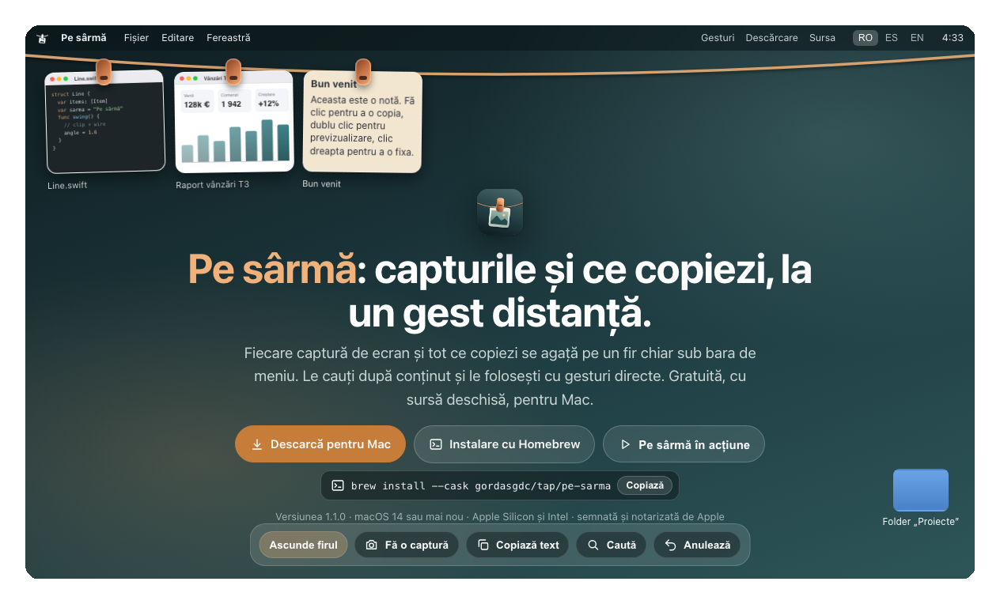
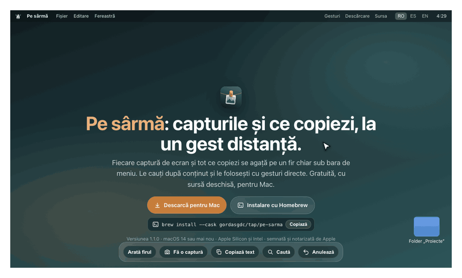

<picture>
  <source media="(prefers-color-scheme: dark)" srcset="docs/media/hero-ro-dark.png">
  
</picture>

<h3 align="center"><a href="https://gordas.dev/pe-sarma/?lang=ro">Încearcă în browser, pe gordas.dev/pe-sarma&nbsp;&rsaquo;</a></h3>

<p align="center">
  Gratuită și cu sursă deschisă. Pentru macOS 14 sau mai nou.
  <br>
  <a href="https://github.com/gordasgdc/pe-sarma/releases/latest">Descarcă&nbsp;&rsaquo;</a>
  &nbsp;&nbsp;
  <a href="#compilare-din-sursa">Compilare din sursă&nbsp;&rsaquo;</a>
  <br><br>
  Română&nbsp;·&nbsp;<a href="docs/i18n/README.en.md">English</a>&nbsp;·&nbsp;<a href="docs/i18n/README.es.md">Español</a>
</p>

<p align="center"><b>Pe sârmă — ediția în limba română, publicată și întreținută de Cristi Gordaș.</b></p>

<br>

## Departe de ochi. La îndemână.

Fiecare captură de ecran și tot ce copiezi se agață pe un fir chiar sub bara de meniu. Lasă cursorul în mijlocul barei și firul coboară; îndepărtează-l și dispare.

<picture>
  <source media="(prefers-color-scheme: dark)" srcset="docs/media/demo-ro-dark.gif">
  
</picture>

<sub>Animația este o simulare a aplicației, cu date sintetice. Cursorul și efectul fiecărui gest se văd în ea.</sub>

<br>

## Un gest pentru fiecare lucru.

| Gest | Efect |
|:--|:--|
| Clic | Copiază. O notă se copiază cu textul formatat. |
| Apăsare lungă | Deschide în Adnotare. O notă se deschide pentru editare. |
| Dublu clic | Deschide în Previzualizare. Un link se deschide în browser. |
| Tragere într-o aplicație | Trimite o copie. Rămâne pe fir. |
| Tragere într-un folder | O păstrezi acolo. Pleacă de pe fir. |
| Tragere în Coș sau clic pe cruciuliță | Scapi de ea. |
| Shift-clic | Selectezi mai multe; meniul, ⌘C, ⌫ și tragerea acționează asupra tuturor. |
| ⌘Z cu cursorul pe fir | Anulează ultima acțiune, inclusiv pentru o selecție. |
| Spațiu cu cursorul pe o imagine | Previzualizare rapidă (Force Touch la fel). |
| Clic dreapta | Partajează, fixează pe fir, ține în fața ferestrelor, arată în Finder. |
| În Finder: clic dreapta → Agață pe fir | O agață pe fir, fixată. |
| ⌃⌥T · ⌃⌥F | Arată sau ascunde firul · caută pe fir (configurabile). |

<br>

## Desktopul tău. În sfârșit liber.

Dă-i capturile tale<sup>1</sup> lui Pe sârmă și sar peste Desktop. Fără miniatură plutitoare, fără așteptare de cinci secunde: fiecare captură se agață în clipa în care o faci, iar doar ce tragi afară rămâne păstrat. Înregistrările de ecran se agață la fel, cu un buton de redare deasupra; apasă lung una ca s-o decupezi. Aceleași scurtături, mai puțină dezordine.

<sup>1</sup> Dacă alegi ca Pe sârmă să gestioneze capturile, aplicația schimbă setările de captură din macOS (`com.apple.screencapture`): locația, miniatura plutitoare și destinația. Valorile tale sunt salvate și puse la loc la dezactivare și la închiderea aplicației.

<br>

## Și text, linkuri, imagini copiate.

Le activezi pe rând, la „Agață ce copiezi”, în bara de meniu. Textul copiat se agață ca o notă (prima linie este titlul, Markdown-ul apare formatat, codul își păstrează liniile). O adresă web se agață ca link, cu site-ul și calea. Nimic nu se păstrează din câmpurile de parolă, din ce marchează ca privat un manager de parole sau din alt dispozitiv prin Clipboard universal.

<br>

## Găsește orice pe fir.

Apasă ⌃⌥F și scrie. Rămân pe fir doar potrivirile: cuvintele din capturi (citite local, pe Mac, în clipa în care se agață) și cuvintele din fiecare notă și link. Căutarea ignoră diacriticele: „sarma” găsește „sârmă”. Return copiază cea mai nouă potrivire.

<br>

## Privat prin construcție.

Fără cont. Fără rețea. Fără statistici. Pe sârmă rulează în întregime pe Mac-ul tău, inclusiv citirea textului din capturi, și nimic din ce agăți nu-l părăsește. Dacă refuzi accesul la un folder, aplicația rămâne pornită, iar capturile din acel folder nu apar pe fir. Jurnalul local de diagnostic este în `~/Library/Logs/PeSarma/`, iar meniul „Diagnostic” exportă un ZIP inspectabil, fără capturi, text copiat sau căi.

<br>

## Specificații

| | |
|:--|:--|
| **Compatibilitate** | macOS 14 Sonoma sau mai nou, Apple Silicon și Intel. |
| **Limbi** | Română, spaniolă, engleză — după limba sistemului (română implicit). O schimbi oricând din meniul pictogramei: Limbă → Română, Español, English sau Limba sistemului. |
| **Construită cu** | Swift, AppKit și SwiftUI. |
| **Acces la rețea** | Niciunul. |
| **Preț** | Gratuită: fără cont, cheie de activare, abonament sau perioadă de probă. |
| **Licență** | MIT pentru cod. Numele și pictograma acestei ediții sunt proprii. |

<br>

## Instalare

Descarcă imaginea disc din [ultima versiune](https://github.com/gordasgdc/pe-sarma/releases/latest) și trage aplicația în Aplicații. Este semnată cu Developer ID și notarizată de Apple.

**https://github.com/gordasgdc/pe-sarma/releases/latest/download/PeSarma.dmg**

Sau cu Homebrew:

```sh
brew install --cask gordasgdc/tap/pe-sarma
```

<br>

## Compilare din sursă

```sh
git clone https://github.com/gordasgdc/pe-sarma.git
cd pe-sarma
PESARMA_BUILD_DIR=/path/to/build scripts/build-app.sh
open /path/to/build/PeSarma.app
```

Necesită uneltele Swift. Verificări: `swift scripts/check-strings.swift`, `scripts/test-selection.sh`, `scripts/test-diagnostics.sh`. Imaginea disc: `NOTARY_PROFILE=<profil> scripts/make-dmg.sh`. Identitatea vizuală: `PESARMA_BRAND_OUT=<folder> scripts/make-brand-assets.sh`. Actualizarea de la Tendedero: [docs/UPSTREAM.md](docs/UPSTREAM.md).

<br>

<p align="center">
  
  <br>
  Pe sârmă este ediția în limba română a <a href="https://github.com/alejandrobujan/tendedero">Tendedero</a>, creat de Alejandro Buján (licență MIT), publicată și întreținută de Cristi Gordaș, cu nume, pictogramă și materiale proprii. Vezi <a href="LICENSE">LICENSE</a> și <a href="NOTICE.md">NOTICE.md</a>.
</p>
