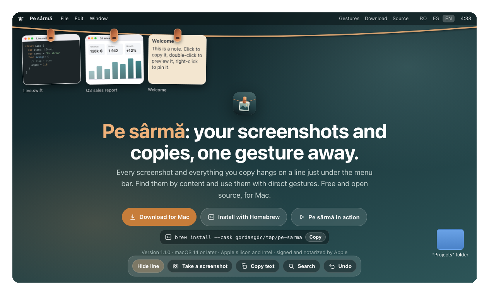
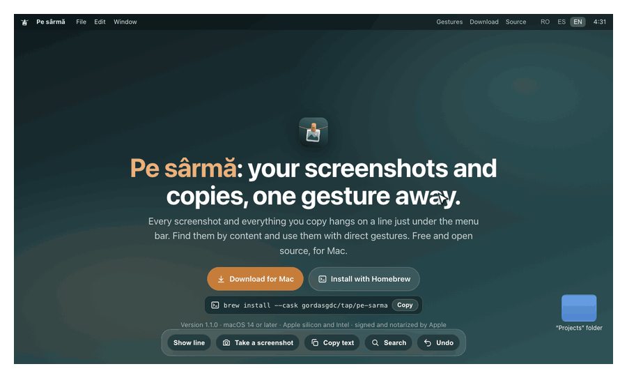

<picture>
  <source media="(prefers-color-scheme: dark)" srcset="../../docs/media/hero-en-dark.png">
  
</picture>

<h3 align="center"><a href="https://gordas.dev/pe-sarma/?lang=en">Try it in your browser at gordas.dev/pe-sarma&nbsp;&rsaquo;</a></h3>

<p align="center">
  Free and open source. For macOS 14 and later.
  <br>
  <a href="https://github.com/gordasgdc/pe-sarma/releases/latest">Download&nbsp;&rsaquo;</a>
  &nbsp;&nbsp;
  <a href="#build-from-source">Build from source&nbsp;&rsaquo;</a>
  <br><br>
  <a href="../../README.md">Română</a>&nbsp;·&nbsp;English&nbsp;·&nbsp;<a href="README.es.md">Español</a>
</p>

<p align="center"><b>Pe sârmă — the Romanian edition, published and maintained by Cristi Gordaș.</b></p>

<br>

## Out of sight. Within reach.

Every screenshot you take, and anything you copy, hangs on a line right under the menu bar. Rest the pointer in the middle of the bar and it glides down; move away and it is gone.

<picture>
  <source media="(prefers-color-scheme: dark)" srcset="../../docs/media/demo-en-dark.gif">
  
</picture>

<sub>The animation is a simulation of the app, with synthetic data. The pointer and the effect of each gesture are visible in it.</sub>

<br>

## A gesture for everything.

| Gesture | Effect |
|:--|:--|
| Click | Copies. A note is copied with its formatted text. |
| Long press | Opens in Markup. A note opens for editing. |
| Double click | Opens in Preview. A link opens in the browser. |
| Drag into an app | Sends a copy. It stays on the line. |
| Drag into a folder | You keep it there. It leaves the line. |
| Drag to the Trash or click the cross | Discards it. |
| Shift-click | Select several; the menu, ⌘C, ⌫ and dragging act on all of them. |
| ⌘Z with the cursor on the line | Undoes the last action, including for a selection. |
| Space over an image | Quick Look (Force Touch too). |
| Right click | Share, pin to the line, keep in front of windows, show in Finder. |
| In Finder: right click → Hang on the line | Hangs it, pinned. |
| ⌃⌥T · ⌃⌥F | Show or hide the line · search the line (configurable). |

<br>

## Your Desktop. Finally clear.

Hand Pe sârmă your screenshots<sup>1</sup> and they skip the Desktop entirely. No floating thumbnail, no five-second wait: each capture hangs the instant you take it, and only what you drag out is kept. Screen recordings hang there too, with a play button over them; press and hold one to trim it. Same shortcuts, just less mess.

<sup>1</sup> If you let Pe sârmă handle screenshots, the app changes the macOS capture settings (`com.apple.screencapture`): the location, the floating thumbnail and the destination. Your values are saved and put back when you turn it off and when the app quits.

<br>

## Copied text, links and images too.

Turn them on one by one under Hang what I copy in the menu bar. Copied text hangs as a note (the first line is the title, Markdown shows formatted, code keeps its lines). A web address hangs as a link, with its site and path. Nothing is kept from a password field, from what a password manager marks as private, or from another device through Universal Clipboard.

<br>

## Find anything on the line.

Press ⌃⌥F and type. Only the matches stay on the line: the words in a screenshot, read on your Mac the moment it hangs, and the words of every note and link. Search ignores diacritics: “sarma” finds “sârmă”. Return copies the newest match.

<br>

## Private by design.

No account. No network. No analytics. Pe sârmă runs entirely on your Mac, reading text in screenshots included, and nothing you hang ever leaves it. If you refuse access to a folder, the app keeps running and screenshots from that folder do not appear on the line. The local diagnostic log is in `~/Library/Logs/PeSarma/`; the Diagnostics menu exports an inspectable ZIP with no screenshots, copied text or paths.

<br>

## Tech Specs

| | |
|:--|:--|
| **Compatibility** | macOS 14 Sonoma or later, on Apple silicon and Intel. |
| **Languages** | Romanian, Spanish, English — following the system language (Romanian by default) or the language set for the app. |
| **Built with** | Swift, AppKit and SwiftUI. |
| **Network access** | None. |
| **Price** | Free: no account, activation key, subscription or trial period. |
| **License** | MIT for the code. The name and icon of this edition are its own. |

<br>

## Install

Download the disk image from the [latest release](https://github.com/gordasgdc/pe-sarma/releases/latest) and drag the app to Applications. It is signed with a Developer ID and notarized by Apple.

**https://github.com/gordasgdc/pe-sarma/releases/latest/download/PeSarma.dmg**

Or with Homebrew:

```sh
brew install --cask gordasgdc/tap/pe-sarma
```

<br>

## Build from source

```sh
git clone https://github.com/gordasgdc/pe-sarma.git
cd pe-sarma
PESARMA_BUILD_DIR=/path/to/build scripts/build-app.sh
open /path/to/build/PeSarma.app
```

Needs the Swift tools. Checks: `swift scripts/check-strings.swift`, `scripts/test-selection.sh`, `scripts/test-diagnostics.sh`. Disk image: `NOTARY_PROFILE=<profile> scripts/make-dmg.sh`. Visual identity: `PESARMA_BRAND_OUT=<folder> scripts/make-brand-assets.sh`. Updating from Tendedero: [docs/UPSTREAM.md](../UPSTREAM.md).

<br>

<p align="center">
  
  <br>
  Pe sârmă is the Romanian edition of <a href="https://github.com/alejandrobujan/tendedero">Tendedero</a>, created by Alejandro Buján (MIT license), published and maintained by Cristi Gordaș, with its own name, icon and materials. See <a href="../../LICENSE">LICENSE</a> and <a href="../../NOTICE.md">NOTICE.md</a>.
</p>
