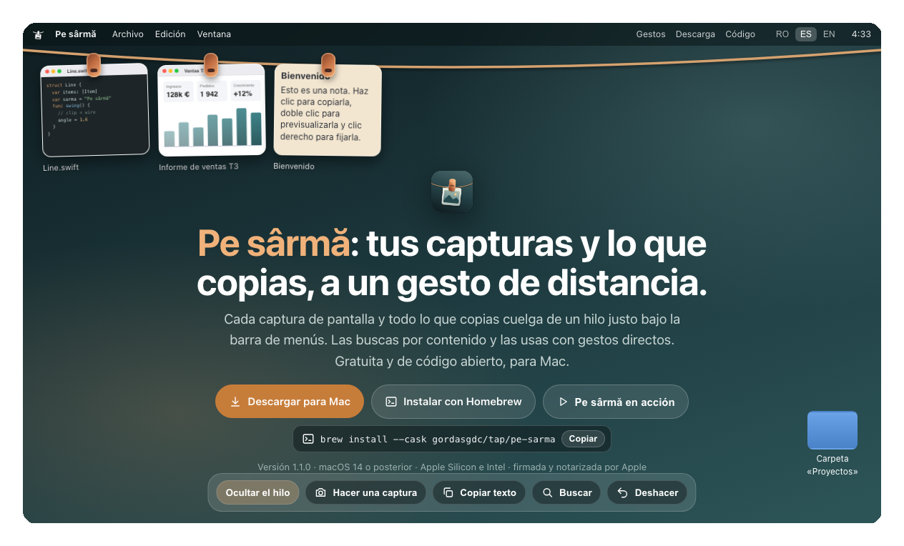
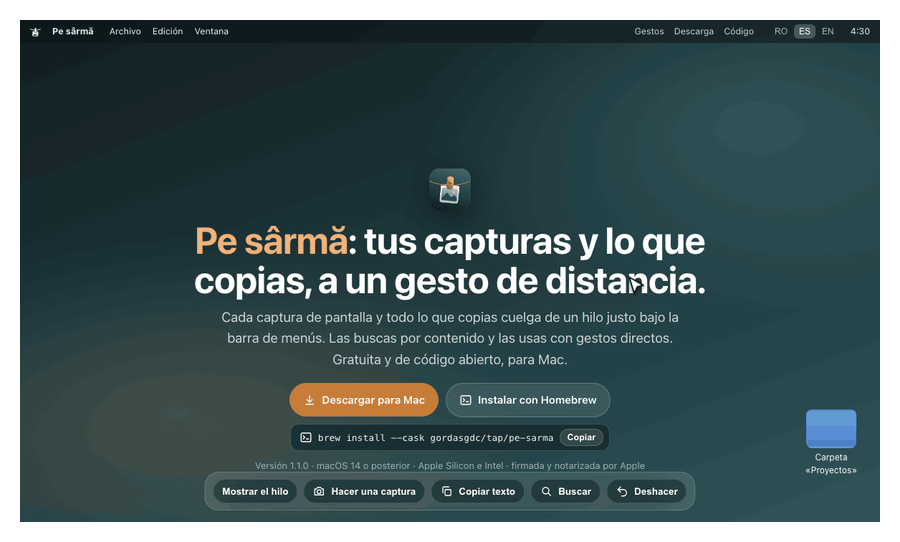

<picture>
  <source media="(prefers-color-scheme: dark)" srcset="../../docs/media/hero-es-dark.png">
  
</picture>

<h3 align="center"><a href="https://gordas.dev/pe-sarma/?lang=es">Pruébalo en el navegador en gordas.dev/pe-sarma&nbsp;&rsaquo;</a></h3>

<p align="center">
  Gratuita y de código abierto. Para macOS 14 o posterior.
  <br>
  <a href="https://github.com/gordasgdc/pe-sarma/releases/latest">Descargar&nbsp;&rsaquo;</a>
  &nbsp;&nbsp;
  <a href="#compilar-desde-el-código">Compilar desde el código&nbsp;&rsaquo;</a>
  <br><br>
  <a href="../../README.md">Română</a>&nbsp;·&nbsp;<a href="README.en.md">English</a>&nbsp;·&nbsp;Español
</p>

<p align="center"><b>Pe sârmă — la edición en rumano, publicada y mantenida por Cristi Gordaș.</b></p>

<br>

## Fuera de la vista. Al alcance.

Cada captura de pantalla y todo lo que copias cuelga de un hilo justo bajo la barra de menús. Deja el cursor en el centro de la barra y el hilo baja; apártalo y desaparece.

<picture>
  <source media="(prefers-color-scheme: dark)" srcset="../../docs/media/demo-es-dark.gif">
  
</picture>

<sub>La animación es una simulación de la app, con datos sintéticos. En ella se ven el cursor y el efecto de cada gesto.</sub>

<br>

## Un gesto para cada cosa.

| Gesto | Efecto |
|:--|:--|
| Clic | Copia. Una nota se copia con su texto con formato. |
| Pulsación larga | Abre en Marcado. Una nota se abre para editar. |
| Doble clic | Abre en Vista Previa. Un enlace se abre en el navegador. |
| Arrastrar a una app | Envía una copia. Sigue en el hilo. |
| Arrastrar a una carpeta | Te la quedas allí. Sale del hilo. |
| Arrastrar a la Papelera o clic en la cruz | La descarta. |
| Shift-clic | Selecciona varias; el menú, ⌘C, ⌫ y el arrastre actúan sobre todas. |
| ⌘Z con el cursor sobre el hilo | Deshace la última acción, también en una selección. |
| Espacio sobre una imagen | Vista rápida (Force Touch también). |
| Clic derecho | Compartir, fijar en el hilo, mantener delante de las ventanas, mostrar en Finder. |
| En Finder: clic derecho → Colgar en el hilo | La cuelga, fijada. |
| ⌃⌥T · ⌃⌥F | Muestra u oculta el hilo · busca en el hilo (configurables). |

<br>

## Tu Escritorio. Por fin despejado.

Dale tus capturas<sup>1</sup> a Pe sârmă y se saltan el Escritorio. Sin miniatura flotante, sin esperar cinco segundos: cada captura cuelga en cuanto la haces, y solo se conserva lo que arrastras fuera. Las grabaciones de pantalla cuelgan igual, con un botón de reproducción encima; pulsa largo en una para recortarla. Los mismos atajos, menos desorden.

<sup>1</sup> Si dejas que Pe sârmă gestione las capturas, la app cambia los ajustes de captura de macOS (`com.apple.screencapture`): la ubicación, la miniatura flotante y el destino. Tus valores se guardan y se restauran al desactivarlo y al cerrar la app.

<br>

## También texto, enlaces e imágenes copiados.

Actívalos uno a uno en «Colgar lo que copio», en la barra de menús. El texto copiado cuelga como una nota (la primera línea es el título, el Markdown se ve con formato, el código conserva sus líneas). Una dirección web cuelga como enlace, con su sitio y ruta. No se guarda nada de campos de contraseña, de lo que un gestor de contraseñas marca como privado ni de otro dispositivo por Portapapeles universal.

<br>

## Encuentra lo que sea en el hilo.

Pulsa ⌃⌥F y escribe. Solo quedan en el hilo las coincidencias: las palabras de una captura, leídas en tu Mac en cuanto cuelga, y las de cada nota y enlace. La búsqueda ignora los diacríticos: «sarma» encuentra «sârmă». Return copia la coincidencia más reciente.

<br>

## Privada por diseño.

Sin cuenta. Sin red. Sin analíticas. Pe sârmă funciona por completo en tu Mac, incluida la lectura del texto de las capturas, y nada de lo que cuelgas sale de él. Si rechazas el acceso a una carpeta, la app sigue abierta y las capturas de esa carpeta no aparecen en el hilo. El registro local está en `~/Library/Logs/PeSarma/`; el menú «Diagnóstico» exporta un ZIP inspeccionable, sin capturas, texto copiado ni rutas.

<br>

## Especificaciones

| | |
|:--|:--|
| **Compatibilidad** | macOS 14 Sonoma o posterior, en Apple silicon e Intel. |
| **Idiomas** | Rumano, español, inglés — según el idioma del sistema (rumano por defecto). Cámbialo cuando quieras desde el menú del icono: Idioma → Română, Español, English o Idioma del sistema. |
| **Hecha con** | Swift, AppKit y SwiftUI. |
| **Acceso a la red** | Ninguno. |
| **Precio** | Gratuita: sin cuenta, clave de activación, suscripción ni periodo de prueba. |
| **Licencia** | MIT para el código. El nombre y el icono de esta edición son propios. |

<br>

## Instalación

Descarga la imagen de disco desde la [última versión](https://github.com/gordasgdc/pe-sarma/releases/latest) y arrastra la app a Aplicaciones. Está firmada con Developer ID y notarizada por Apple.

**https://github.com/gordasgdc/pe-sarma/releases/latest/download/PeSarma.dmg**

O con Homebrew:

```sh
brew install --cask gordasgdc/tap/pe-sarma
```

<br>

## Compilar desde el código

```sh
git clone https://github.com/gordasgdc/pe-sarma.git
cd pe-sarma
PESARMA_BUILD_DIR=/path/to/build scripts/build-app.sh
open /path/to/build/PeSarma.app
```

Requiere las herramientas de Swift. Comprobaciones: `swift scripts/check-strings.swift`, `scripts/test-selection.sh`, `scripts/test-diagnostics.sh`. Imagen de disco: `NOTARY_PROFILE=<perfil> scripts/make-dmg.sh`. Identidad visual: `PESARMA_BRAND_OUT=<carpeta> scripts/make-brand-assets.sh`. Actualizar desde Tendedero: [docs/UPSTREAM.md](../UPSTREAM.md).

<br>

<p align="center">
  
  <br>
  Pe sârmă es la edición en rumano de <a href="https://github.com/alejandrobujan/tendedero">Tendedero</a>, creado por Alejandro Buján (licencia MIT), publicada y mantenida por Cristi Gordaș, con nombre, icono y materiales propios. Consulta <a href="../../LICENSE">LICENSE</a> y <a href="../../NOTICE.md">NOTICE.md</a>.
</p>
